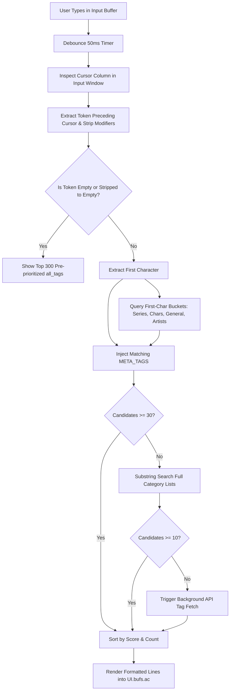

# AGENTS.md — Technical Architecture & Contributor Specification for `gelbooru.nvim`

This document is the primary technical reference and architectural specification for AI agents and human maintainers working on `gelbooru.nvim`. It provides an authoritative description of the plugin's architecture, user interface, networking layer, hybrid library engine, tag database, autocomplete pipeline, image rendering system, core engineering invariants, testing protocols, and development roadmap.

---

## 1. Executive Summary

`gelbooru.nvim` is a high-performance, asynchronous Neovim plugin designed for searching, browsing, and inspecting images and metadata from the Gelbooru imageboard directly inside the editor, featuring unified local library browsing and offline booru metadata enrichment.

### Key Capabilities
- **Local Tag Indexing & Instant Autocomplete**: Loads and indexes 100k+ tags across five distinct categories (Series, Characters, Artists, General, Meta). The debounced completion engine provides sub-3ms prefix lookups with popularity-weighted scoring, substring fallbacks, and dynamic API discovery.
- **Unified Online & Local Library Engine**: Browse Gelbooru online or your saved local folders seamlessly through a unified query bar (`local: [tags]` or online tags), sharing layout, history, image rendering, and metadata inspector.
- **Offline Booru Metadata Enrichment**: Enriches locally saved images and videos with live Gelbooru post metadata, tags, ratings, and artist categorization via fast ID extraction and disk caching.
- **In-Editor Image Rendering**: Leverages `snacks.image` (supporting Kitty graphics protocol, Ghostty, Wezterm, and terminal pixel renderers) to display high-resolution post previews inside floating windows. Includes video detection, local disk caching, prefetching, and fallback chains.
- **Interactive Multi-Window UI**: Floating layout featuring a top search bar, live autocomplete dropdown, scrollable post list, full image canvas, expandable metadata inspector, and status line.
- **Zero Heavy Runtime Dependencies**: Pure Lua codebase requiring only Neovim (>= 0.9.0), system `curl`, and an image backend (`snacks.nvim` or `image.nvim`).

---

## 2. Commands, Query Syntax & Interaction Model

### 2.1 Public Commands & Setup
- `:Gelbooru [tags]` (or `:Gelbooru`): Opens the browser window. If initial tags are passed (e.g. `:Gelbooru hatsune_miku rating:general`), immediately executes the search; otherwise opens with focus in the search bar.
- `:GelbooruLocal [dir]`: Opens the local folder browser for saved images and videos (defaults to `config.options.save_dir` if omitted).
- `:GelbooruTags [args]` (alias `:GelbooruTag`): Initiates the background tag scraper and database builder (`:GelbooruTags`), batch tag verification (`:GelbooruTags verify`), or top-down count refresh (`:GelbooruTags refresh`). Displays a floating progress spinner.
- `require("gelbooru").setup(opts)`: Configures paths, network limits, prefetch radius, and logging.

### 2.2 Unified Query Bar Syntax
The top query bar accepts both online and local library search expressions:
- `tag1 tag2 rating:general` — Online Gelbooru search across tags and meta modifiers. Direct API pass-through preserves remote sorting directives (`sort:score`, `sort:id`, `sort:random`).
- `local:` or `local: [tags]` — Search default `save_dir` local library, optionally filtering by booru tags or keywords (e.g. `local: zenless_zone_zero`).
- `local:<dir> [tags]` — Search a custom local directory, optionally filtering by tags.
- `local: sort:<key>[:<dir>]` — Local library sorting directives:
  - `sort:score` / `sort:score:asc` — Sort local posts by metadata score (descending/ascending), utilizing disk metadata cache for instant sorting.
  - `sort:id` / `sort:id:asc` — Sort local posts by Gelbooru post ID (newest/oldest).
  - `sort:date` / `sort:date:asc` (`sort:mtime`) — Sort local posts by file modification timestamp (`mtime`).
  - `sort:random` / `order:random` / `random` — Randomly shuffle matching local files using Fisher-Yates algorithm.
- `id:<digits>` or bare `<digits>` — Directly loads a single post by its Gelbooru numeric ID.
- **Multi-Stage Cascading Pipeline Syntax**: Unix pipe syntax (`|`) or space-separated sort/limit directives chain filtering stages:
  - `tag1 tag2 | sort:id:1000..1200 | sort:score:50 | sort:random`
  - Range & Offset Jumping: `500..600`, `sort:id:1000..1200`, `limit:1000..1200`, `offset:1000`. Recognizes bare ranges (`%d+..%d+`) and limit directives after pipes. Starts remote fetching directly at server page `pid = math.floor(offset / 100)`, bypassing unneeded network roundtrips and slicing the exact window in memory.
  - In-Session TTL Query Caching: In-memory candidate pool (`pool::<tags>:pid=<pid>`) and page batch (`page::<query>:pid=<pid>`) caching with 5-minute TTL. Adding or tweaking query conditions re-evaluates cached candidate pools instantly without re-fetching 500 images over the network. If `pid = 0` pool already covers requested offset and limits, slices directly from memory with zero network requests. Zero disk persistence across Neovim sessions; preserved across UI opens/closes with a 5-minute TTL, and force-refreshed on `R`.


### 2.3 Three-Mode Interaction Model

The UI operates in three distinct, coordinated modes: **Browse Mode** (post list focused), **Metadata Inspector Mode** (`meta` window focused), and **Search Mode** (query input focused).

#### 1. Browse Mode (List Window Focused)
When viewing posts, the post list window is focused with `cursorline` enabled:

| Key | Action | Technical Behavior |
|---|---|---|
| `j` / `k` | Move cursor down / up | Updates `State.cur` and `State.scroll_dir`. Updates history entry. Re-renders post list, triggers debounced preview render (30ms if cached, 150ms if remote), initiates background prefetching/lookahead for adjacent posts, and auto-fetches the next page when nearing the boundary (`#posts - 5`). |
| `gg` / `G` | Jump top / bottom | Navigates to first/last post, synchronizes `State.cur`, and updates preview canvas. |
| `<CR>` | Save image / Notice | In online mode: downloads full-resolution `file_url` to `config.options.save_dir` and automatically caches metadata to `<cache_dir>/meta_<id>.json`. In local mode (or if already saved in `save_dir`): displays local file path notice without triggering download or opening external viewer. |
| `<Tab>` | Next Page | Fetches the next page (`pid = State.page + 1`) from the Gelbooru API and appends posts (online search). |
| `<S-Tab>` | Previous Page | Rewinds to the previous page by removing the oldest batch of posts and decrementing `State.page`. |
| `r` | Re-render preview | Resets `State.cur_id` and re-renders current post preview canvas and metadata without deleting cached files. |
| `R` | Force refresh | Invalidates volatile preview cache in `/tmp/gelbooru_cache/prev_<id>.<ext>` and metadata cache in `<cache_dir>/meta_<id>.json`, clears snacks image cache, and re-fetches metadata and preview from network. Strictly **NEVER** touches, modifies, or deletes permanent files in `save_dir` or local user libraries. |
| `m` | Toggle metadata panel | Toggles `State.show_meta` boolean. Recalculates floating layout dimensions via `calc_layout()`, hides or displays the metadata window (`wins.meta`) and divider (`wins.hdiv`), and adjusts preview canvas height. |
| `M` | Focus metadata inspector | Ensures `State.show_meta = true`, recalculates layout, and transfers window focus to `UI.wins.meta` with `cursorline = true` for deep tag inspection. |
| `u` | Quick Artist Search | Single-key artist lookup. Extracts the artist tag of the focused post and immediately populates and queries it in the search bar. |
| `d` / `D` | Delete local file | Opens centered floating confirmation modal (`j`/`k` to navigate between Yes and Cancel, `<CR>` to confirm, `y`/`n`/`<Esc>` shortcuts). Stages the file for deferred deletion in `State.pending_deletions`. Immediately removes `[SAVED]` badge from list while keeping preview canvas and metadata fully rendered. Physical unlinking is deferred to `ui.teardown()`. Pressing `<CR>` before exit cancels deferred deletion and restores `[SAVED]` without network re-download. Restores preview canvas upon modal exit. |
| `o` | Open post web page | Spawns system default browser with full post page (`https://gelbooru.com/index.php?page=post&s=view&id=...`). |
| `O` | Open locally with media viewer | Opens media file directly in system media viewer (`open` on macOS honoring Finder default such as IINA, `xdg-open` on Linux, or user-configured `config.options.media_player`). If post is not downloaded yet, automatically downloads it to `save_dir` first, then opens it locally. |
| `<` / `>` | Adjust explorer width | Increments or decrements post list width ratio (`State.list_width_ratio`, clamped 0.10–0.40, default 0.25), dynamically resizing image canvas and nudging placement. |
| `\` | Toggle Zen Mode | Collapses post list to 0 width, allocating 100% of display width to the image canvas for full-screen viewing; pressing `\` restores list. Maintains focus on list window and disables list cursorline to eliminate cursor artifacts while enabling seamless up/down navigation. |
| `i`, `I`, `a`, `A`, `s`, `S`, `/` | Enter Search Mode | Shifts focus to input window, enters insert mode, sets `State.input_focused = true`, pops open autocomplete dropdown (`wins.ac`), and updates completion candidates. |
| `[` / `]` | Previous / Next History | Navigates search history stack (`history_prev` / `history_next`), restoring queries, post arrays, and cursor positions. |
| `<C-d>` / `<C-u>` | Scroll metadata | Scrolls metadata text buffer down / up by 5 lines without shifting focus. |
| `<ScrollWheelDown>` / `<ScrollWheelUp>` | Scroll metadata | Scrolls metadata text buffer by 3 lines via mouse wheel. |
| `q` / `<Esc>` | Quit / Close | Initiates complete UI teardown: cancels timers, terminates in-flight downloads, closes all floating windows, resets state tables, and triggers garbage collection. |

#### 2. Metadata Inspector Mode (Meta Window Focused)
Entered via `M` from the list window:

| Key | Action | Technical Behavior |
|---|---|---|
| `h`, `j`, `k`, `l`, `w`, `b`, `e` | Native cursor navigation | Standard Vim motion across metadata lines, artist credits, and tag badges. |
| `gg` / `G` | Jump to top / bottom | Navigates to first line (`ID: ...`) or bottom of tag list. |
| `<C-d>` / `<C-u>`, `<C-f>` / `<C-b>` | Page scrolling | Half-page and full-page scrolling natively in metadata buffer. |
| `v`, `V`, `y` | Visual select & yank | Standard Vim yanking allows copying exact tag names or post IDs directly into registers. |
| `q`, `<Esc>`, `M` | Return to post list | Restores focus to `UI.wins.list` without altering scroll position. |
| `m` | Hide & return to list | Sets `State.show_meta = false`, recalculates layout to hide meta panel, and returns focus to `UI.wins.list`. |
| `u` | Quick Artist Search | Immediately queries the artist of the active post in the search bar. |
| `d` / `D` | Delete local file | Prompts confirmation dialog to delete local file while maintaining viewer focus. |
| `/`, `i`, `I`, `a`, `A`, `s`, `S` | Jump to search | Transitions directly into Search Mode in the input bar. |
| `o` | Open web page | Opens full post URL (`https://gelbooru.com/index.php?page=post&s=view&id=...`) in default browser. |
| `O` | Open locally | Opens local media file in system viewer (`open`, VLC, IINA, Preview), downloading first if not yet downloaded. |
| `<CR>` | Save image / Notice | In online mode: downloads full-res media to `save_dir`. In local mode: displays local file notice. |

#### 3. Search Mode (Input Window Focused)
When typing in the query bar, the autocomplete window (`wins.ac`) displays matching tags ranked by relevance and category:

| Key | Action | Technical Behavior |
|---|---|---|
| `<Tab>` / `<Down>` / `<C-n>` | Navigate suggestion down | Sets `State.autocomplete_navigated = true`, increments `State.autocomplete_cur`, highlights candidate line in `wins.ac`. |
| `<S-Tab>` / `<Up>` / `<C-p>` | Navigate suggestion up | Sets `State.autocomplete_navigated = true`, decrements `State.autocomplete_cur`, moves highlight line. |
| `<Space>` | Contextual select or space | **If Tab-navigated (`autocomplete_navigated == true` and `cur > 0`)**: Selects highlighted suggestion, appends with trailing space, resets navigation flag.<br>**If typing**: Auto-selects only if typed word is exact/normalized match; otherwise inserts literal space. |
| `<CR>` | Execute search | Reads input line (committing navigated autocomplete candidate if active), exits insert mode, pushes query to history stack, resets pagination, clears current post list, triggers search execution, and starts background lookup for unindexed query tags. |
| `jk` / `<Esc>` / `<C-[>` | Exit search via `InsertLeave` | **Automatic `InsertLeave` autocommand**: Catches all insert-mode exits, automatically clears `State.input_focused`, hides autocomplete popup (`wins.ac`), and restores focus to `UI.wins.list`. |
| `<BS>` (normal mode) | Edit query | Seamlessly re-enters insert mode with backspace behavior, preventing users from getting trapped in normal mode. |
| `q`, `j`, `k` (normal mode) | Defensive exit to list | If input buffer lands in normal mode, pressing `q`, `j`, `k`, or `<Esc>` exits to post list immediately. |
| `i`, `I`, `a`, `A`, `s`, `S`, `/` (normal mode) | Defensive re-enter search | Re-enters insert mode, sets `State.input_focused = true`, and reopens autocomplete popup. |

### 2.4 Mouse Interaction & Boundary Protection
- **Mouse Focus & Unified Routing**: Mouse clicks are supported to easily switch focus between interactive windows (`input`, `list`, `meta`). Clicking on `UI.wins.list` navigates post items. Clicking outside the list (on `img`, dividers, `status`, `frame`, or background editor) keeps/restores focus to `UI.wins.list` and strictly pins the list cursor to `State.cur`, preventing any displacement. On teardown, original `vim.o.mouse` setting is strictly restored.
- **Window Focus & Global Key Neutralization (`util.shield_buffer`)**: Decorative dividers (`frame`, `div`, `vdiv`, `hdiv`, `status`, `ac`, `img`) have `focusable = false`. All Gelbooru buffers (`list`, `meta`, `input`, `img`, modals, frames) are shielded via `util.shield_buffer`, setting `which_key_ignore = true`, `whichkey_disable = true`, `miniclue_disable = true`, and mapping `<Space>`, ` `, `<Leader>`, `<Localleader>` with `nowait = true` to silent no-op, preventing global leader and plugin menus from leaking into the UI.
- **Defensive Boundary Keymaps**: Mouse clicks (`<LeftMouse>`, `<2-LeftMouse>`, `<RightMouse>`) on non-interactive buffers (`frame`, `div`, `vdiv`, `hdiv`, `status`, `ac`, `img`) route through the unified click handler. Pressing `/` or `i` transitions to search mode, and `q` or `<Esc>` returns to the post list.

---

## 3. Repository Architecture & Module Hierarchy

### 3.1 File Hierarchy

```
gelbooru.nvim/
├── Makefile                          # Test runner, linter, single-spec targets
├── tests/
│   ├── minimal_init.lua              # Headless Neovim test bootstrap (rtp & plenary resolution)
│   ├── unit/
│   │   ├── canvas_spec.lua           # Terminal canvas adapter, DPI clamping, placement isolation
│   │   ├── config_spec.lua           # Options, defaults, clamping, aliasing
│   │   ├── db_spec.lua               # Tag validation (is_clean_tag), indexing, bucketing
│   │   ├── download_spec.lua         # Download engine, deduplication, retry, queue pruning
│   │   ├── history_spec.lua          # Stack push/pop/restore, reference semantics, FIFO cap
│   │   ├── local_spec.lua            # Local folder scanning, ID parsing, query parsing, enrichment
│   │   ├── media_resolver_spec.lua   # Media resolution, binary validation, video thumbnails, caching
│   │   └── util_spec.lua             # URL encoding, entity decoding, fuzzy matching
│   └── integration/
│       ├── autocomplete_spec.lua     # Dropdown population, selection index advancement
│       ├── layout_spec.lua           # Layout math, window visibility, metadata formatting
│       ├── local_spec.lua            # End-to-end local browser workflow & query filtering
│       ├── minor_features_spec.lua   # Zen mode, width resizing, hotkey dispatch
│       ├── pipeline_stress_spec.lua  # Pipeline multi-stage slicing, candidate pools, concurrency & race safety
│       ├── regressions_spec.lua      # Guards against placement tearing, blanking, locks
│       ├── search_spec.lua           # Search execution, cursor reset, list repainting
│       ├── tag_menu_spec.lua         # (Planned) Interactive tag picker modal (t/T), exclusion, Yank, confirm modal, focus
│       └── helpers/
│           ├── harness.lua           # Headless environment setup/teardown & memory isolation
│           ├── mock_net.lua          # Network API stubs for curl and async downloads
│           └── mock_snacks.lua       # Mocks snacks.image.placement for headless testing
└── lua/gelbooru/
    ├── init.lua                      # Top-level API entry point & user command bindings
    ├── core/
    │   ├── config.lua                # Configuration defaults, clamping, option normalization
    │   ├── constants.lua             # Centralized layout clamps, scoring weights, timeouts & limits (130 lines)
    │   ├── state.lua                 # Global session state singleton (State & UI handles)
    │   ├── history.lua               # Bounded query navigation stack with reference sharing
    │   ├── util.lua                  # Pure helpers (encoding, HTML decode, auth cache, window helpers)
    │   └── log.lua                   # Structured disk logger writing to stdpath("state")/gelbooru.log
    ├── local/
    │   ├── init.lua                  # Local browser facade & open_local orchestrator
    │   ├── index.lua                 # O(1) integer hash index of saved files & mtime validator
    │   ├── indexer.lua               # Dual-tier cursor rush prefetcher & background metadata indexer
    │   ├── query.lua                 # Query parser for local expressions & tag/rating/score filter
    │   └── scan.lua                  # Fast & safe directory scanner & post ID extractor
    ├── media/
    │   └── resolver.lua              # Headless media resolver, binary validation, video thumbnails, caching
    ├── net/
    │   ├── init.lua                  # Facade re-exporting API and download submodules
    │   ├── api.lua                   # Gelbooru REST client, query execution, metadata hydration
    │   └── download.lua              # Async curl download queue, dedup, retry, & prefetch scheduler
    ├── query/
    │   ├── init.lua                  # Dedicated query package facade (parse, filter, sort, pipeline)
    │   ├── parse.lua                 # Query tokenizer & modifier parser (rating:, score:, -tag, ranges)
    │   ├── pipeline.lua              # Piped query parser (|) and stage execution engine
    │   ├── sort.lua                  # Post sorting engine (score, id, mtime, random)
    │   └── filter.lua                # Post matching and condition filter engine
    ├── tags/
    │   ├── init.lua                  # Facade re-exporting db, fetcher, resolve submodules
    │   ├── db.lua                    # Tag loading, memory indexing, bucketing, validation
    │   ├── fetcher.lua               # Background scraper (:GelbooruTags) with checkpointing & backoff
    │   └── resolve.lua               # Post tag batch resolution & runtime discovered.json cache
    └── ui/
        ├── init.lua                  # Thin facade re-exporting all public symbols from UI submodules
        ├── autocomplete.lua          # Autocomplete engine (prefix bucketing, scoring, fallback)
        ├── canvas.lua                # Terminal canvas adapter (snacks placement, DPI clamping, placeholders)
        ├── layout.lua                # Window geometry calculation, responsive scaling, divider buffers
        ├── keymaps.lua               # Buffer-local keymaps (list, meta, input, non-interactive shielding)
        ├── render.lua                # Post list formatting, metadata panel rendering, confirm modal
        └── lifecycle.lua             # Buffer/window creation, autocommands, teardown & cleanup
```

### 3.2 Module Responsibilities

#### `lua/gelbooru/init.lua`
Public entry point. Exposes `setup(opts)`, `open(initial_tags)`, `local_browser(dir)`, `browse()`, and `update_tags()`. Connects user-facing commands to core logic.

#### `lua/gelbooru/core/config.lua`
Holds the default configuration table. Normalizes user overrides, clamps numeric ranges using `math.max` and `math.min`, maps tag category IDs to badges and string names, and declares static `META_TAGS` (`id:`, `sort:score`, `rating:general`, etc.).

#### `lua/gelbooru/core/constants.lua`
Centralized configuration table (130 lines) consolidating 65+ named constants across 13 modules: layout dimension ratios, window z-indices, scoring weights, popularity multipliers, debounce intervals, network timeouts, and binary validation size floors across the plugin.

#### `lua/gelbooru/core/state.lua`
Declares the two foundational singletons:
- `M.State`: Session runtime state (current query, posts array, pagination indices, current cursor, tag category lists, first-letter bucket indices, autocomplete buffers, history stack, saved index, pending deletions, pending tag prunes).
- `M.UI`: Window IDs, buffer IDs, autocmd group, active placement handle, and libuv timers (`scroll_timer`, `status_timer`, `api_tag_timer`, `ac_debounce_timer`, `save_discovered_timer`, `prune_disk_timer`, `fetcher_timers`, `tags_spinner_win`, `prefetch_timers`, `resize_timer`).
Provides lifecycle cleanup routines: `reset_query_state()`, `reset_ui()`, and `reset_tag_state()`.

#### `lua/gelbooru/core/history.lua`
Maintains a bounded undo/redo navigation stack for search queries (capped at `MAX_HISTORY = 30`). Stores `posts` arrays by reference. In `restore_history(idx)`, immediately closes active image placement, increments `State.search_epoch`, cancels prefetch timers and indexer tasks, and resets image and metadata buffers.

#### `lua/gelbooru/core/util.lua`
Pure utility functions: URL encoding with proper percent-encoding, alphanumeric string normalization, HTML entity decoding, credential loading, defensive line setters, non-blocking URL and media opener dispatch, and floating window creation wrapper.

#### `lua/gelbooru/net/api.lua`
Handles Gelbooru REST API interactions:
- `fetch(direction)`: Forward and backward post pagination with `search_epoch` validation.
- `execute_search(query)`: Pushes history, clears post state, cancels active prefetch and background indexer, closes active image placement, resets canvas and metadata, normalizes bare numeric IDs, and executes search.
- `save_current()`: Downloads full-size media to `save_dir`, writes metadata JSON to cache, and upgrades active canvas on completion.
- `fetch_post_metadata(p, cb)`: Resolves full booru post details by numeric ID with disk caching and retry tolerance on network failure.
- `execute_piped_search(query, pipe)`: Executes multi-stage pipeline queries, utilizing 5-minute TTL candidate pool caching (`pool::<tags>`) with shallow array reference copying (LuaJIT heap discipline) and offset page jumping.
- `check_self_heal(query_str, cb)`: Query-time self-healing hook triggered when single-tag searches return 0 results to verify tag existence via API and evict dead/aliased tags from memory and disk.

#### `lua/gelbooru/net/download.lua`
Network transfer engine using `vim.system({"curl", ...})`:
- `curl_async(url, cb)`: Lightweight async GET returning response body.
- `download_async(url, dest, cb, opts)`: File downloader with deduplication (`active_downloads[dest]`), atomic writing via `.part` files, referer headers, retry logic, callback queue pruning, strict HTTP(S) protocol validation (`^https?://`), and post-download binary integrity validation (`is_valid_media`).
- `is_valid_media(file_path, ref_path)`: High-performance (<0.02ms) binary validator checking SOI/EOI markers for JPEG (`\xFF\xD8` and `\xFF\xD9`), `IEND` chunk for PNG, trailer `;` (0x3B) for GIF87a/89a, `RIFF` and `WEBP` headers for WebP, `ftyp` box for MP4/MOV, rejecting HTML/XML error bodies, and enforcing format-specific size floors.
- `resume_pending_saves()`: Resumes interrupted downloads using `.part` files on startup, normalizing single-post API responses with `util.ensure_array`.
- `prefetch_around(idx)`: Calculates prefetch indices based on `prefetch_radius` and scroll direction, scheduling staggered async downloads into local preview cache with teardown guards and background ffmpeg thumbnail extraction for saved local videos.
- `cancel_pending_resumes()`, `cancel_prefetch_timers()`: Manages and cleans up deferred retry and prefetch timer handles.

#### `lua/gelbooru/local/init.lua`
Local folder browser subsystem facade: coordinates `scan_local_folder`, query parsing via `local/query.lua`, canvas clearing, history synchronization, and metadata hydration.

#### `lua/gelbooru/local/index.lua`
Maintains flat integer hash table `saved_index[tonumber(id)] = ext` mapping downloaded files in `save_dir`. Tracks directory `mtime` to avoid redundant filesystem traversal. Exposes `mark_saved(id, ext)` and `reset()`.

#### `lua/gelbooru/local/indexer.lua`
Dual-tier lookahead engine:
- **Tier 1 (High Priority - Cursor Rush)**: Hydrates metadata immediately around active cursor in `scroll_dir`.
- **Tier 2 (Background - Folder Indexer)**: Throttled async queue crawling unindexed posts with max 2 concurrent workers and 100ms pacing, aborted cleanly on navigation or teardown.

#### `lua/gelbooru/local/query.lua`
Compatibility re-export layer: cleanly re-exports all functions, submodules, and interfaces from the dedicated `lua/gelbooru/query/` package (`parse_query`, `filter_posts`, `sort_posts`, `execute_pipeline`, etc.) ensuring seamless zero-breaking-change backwards compatibility for existing plugins and tests requiring `gelbooru.local.query`.

#### `lua/gelbooru/query/`
Dedicated query parser, filtering, pipeline execution, and sorting package:
- `query/init.lua`: Top-level facade exposing unified parsing, filtering, sorting, and pipeline functions and submodule handles (`parse`, `pipeline`, `sort`, `filter`).
- `query/parse.lua`: Query tokenizer (`tokenize_query`), modifier parser (`rating:`, `score:`, `local:`, `-tag`, `id:`, tilde/pipe OR syntax), directory detector, and numeric/range bound parser (`50..`, `..100`).
- `query/pipeline.lua`: Pipeline parser (`parse_pipeline` with pipe `|` splitting) and cascading stage execution engine (`execute_pipeline` with offset/limit/range slicing and sorting).
- `query/sort.lua`: Post sorting engine (`sort_posts`) supporting `score`, `id`, `date`/`mtime`, and `random` with disk metadata score hydration and filesystem timestamp fallback.
- `query/filter.lua`: Post matching engine (`matches_post` / `matches_query`) and collection filtering (`filter_posts`).

#### `lua/gelbooru/local/scan.lua`
Safe directory traversal and post ID extractor using `vim.loop.fs_scandir`. Safely parses filenames with unicode, spaces, multiple dots, and brackets without external shell subshells. Falls back to `fs_stat` when filesystem returns nil `ftype`. Enforces a sequential filename collision guard (`id >= 10000` for bare numeric filenames like `1.png` or `42.jpg`) while preserving explicit booru prefixes (`gelbooru_`, `post_`, `id_`, `ID`, `prev_`).

#### `lua/gelbooru/tags/db.lua`
Local tag indexing and categorization: strict validation heuristic (`is_clean_tag`), memory indexing into first-letter bucket tables, and category composite list creation. Preserves `local_only` flags on metadata tags. Supports in-place count and category synchronization (`update_tag_in_index`), tag eviction (`prune_tag`), query-time verification hook (`verify_and_prune_tag`), and debounced disk database purging (`schedule_disk_prune`, `prune_tags_from_disk`).

#### `lua/gelbooru/tags/fetcher.lua`
Tag database maintenance engine (`:GelbooruTags`, `:GelbooruTags verify`, `:GelbooruTags refresh`):
- `update_tags()`: Concurrent worker loops building full tag category databases with JSON response verification, exponential backoff on Cloudflare/429 HTML responses, live animated progress spinner, memory synchronization, and atomic checkpointing. Guarded by `M.is_running` against re-entrancy.
- `verify_tags()`: High-speed batch verification checking existing tag databases against Gelbooru's multi-tag API in chunks of 50–100 names, synchronizing counts in-place, dynamically reclassifying changed tag categories, and purging dead tags.
- `refresh_tags()`: Top-down count crawler scraping from page 0 downwards to update the top 50,000 most popular tags in-place without rebuilding databases from scratch.
- Manages retry timers via `UI.fetcher_timers` and tracks progress window handle in `UI.tags_spinner_win` for clean teardown.

#### `lua/gelbooru/tags/resolve.lua`
Dynamic post tag categorization: extracts unindexed tags from posts, batches queries to the Gelbooru tag API, persists discovered tags to `discovered.json` (debounced 500ms), and provides live API fallback when local matches are sparse. Strictly clears `UI.api_tag_timer = nil` before closing timer handles to prevent stale handle leaks.

#### `lua/gelbooru/ui/init.lua`
Thin facade (145 lines) providing a unified public entry point and backwards-compatible interface for the UI subsystem. Re-exports all public symbols, lifecycle functions, layout helpers, keymaps, and render functions from the four specialized submodules (`ui/layout.lua`, `ui/render.lua`, `ui/keymaps.lua`, and `ui/lifecycle.lua`), ensuring zero breaking changes for existing external consumers and tests.

#### `lua/gelbooru/ui/autocomplete.lua`
Real-time tag autocompletion engine: cursor-column token extraction, sub-3ms lookup using first-character bucket tables, empty token protection, popularity-weighted candidate scoring, category badge formatting, and context-aware scoping (suppressing `local_only` sorting tags in online queries with zero keystroke lag).

#### `lua/gelbooru/media/resolver.lua`
Headless media resolution and validation engine: handles URL hierarchy resolution (`sample_url` -> `preview_url` -> `file_url`), pure Lua binary header dimension extraction (`read_image_dimensions` for PNG, JPEG, GIF, WebP), binary format completion verification (`is_image_complete`), background video thumbnail extraction (`extract_video_thumbnail`) with atomic `.part` writing and active process tracking (`active_ffmpeg_handles`), volatile cache purging (`clear_cache`, `clear_snacks_cache_for`), and clean job cancellation (`abort_active`, `abort_video_transcodes`).

#### `lua/gelbooru/ui/canvas.lua`
Terminal canvas adapter: placement creation and lifecycle isolation using `snacks.image.placement`, corrupt/extreme DPI header sanitization (`sanitize_dpi` clamping `>= 300` and `< 50` to standard 96 DPI), immediate in-flight conversion abortion (`abort_convert` -> `img._convert:abort()`), text/video placeholder rendering (`render_placeholder`), in-place placement resize nudging (`nudge`), placement teardown (`close`), and defensive buffer keymap shielding.

#### `lua/gelbooru/ui/layout.lua`
Floating window geometry calculation and responsive scaling (259 lines): computes terminal dimension bounds (`calc_layout`), handles responsive resizing clamps (`MIN_COLS`, `MIN_LINES`), manages list and preview window width ratios (`State.list_width_ratio`, Zen mode collapse), and generates decorative divider lines (`─`, `│`) for `div`, `vdiv`, `hdiv`, and outer `frame` buffers.

#### `lua/gelbooru/ui/keymaps.lua`
Buffer-local keybindings and mouse event routing (576 lines): binds interactive normal/insert mode actions across post list, metadata inspector, and query search bar; sets up defensive non-interactive buffer shielding (`util.shield_buffer`) to isolate leader keys and prevent menu leaks; attaches image buffer navigation fallbacks; handles confirmation modal inputs; and routes mouse click events safely.

#### `lua/gelbooru/ui/render.lua`
Visual display rendering and presentation coordinator: lean `load_and_render_image` coordinator (< 45 lines) requesting async resolution from `media.resolver.resolve` with cursor epoch guards and delegating display to `ui.canvas.render` / `ui.canvas.render_placeholder`, post list text formatting with cursor indicators and badges (`[SAVED]`, `[VIDEO]`), full metadata panel rendering with category color highlighting, preview cooldown timers and debounced dispatch, dynamic status line generation (active queries, modes, pagination), and floating deletion confirmation modal rendering.

#### `lua/gelbooru/ui/lifecycle.lua`
Window and buffer lifecycle management (484 lines): floating window and buffer creation (`ensure_ui`), public entry points (`open`, `open_local`, `browse`), window focus management and mode transitions, autocommand group registration (`VimResized`, `CursorMoved`, `InsertLeave`), search input submission and exit handling, and complete resource teardown (`teardown` cancelling timers, aborting downloads and child processes, closing placement, and closing windows).

---

## 4. Subsystem Deep-Dives

### 4.1 Window Layout Hierarchy & Geometry

`ui/init.lua` calculates a unified layout occupying 95% of terminal width and height (clamped to minimum 80 columns × 20 rows):

```
┌────────────────────────────────── frame (95% W x 95% H) ───────────────────────────────────┐
│ input: search query bar                                                       [zindex: 51] │
├────────────────────────────────── div: horizontal rule ────────────────────────────────────┤
│ list: 25% W (adjustable via < >)│ img: 75% W (expands to 100% in Zen Mode '\')              │
│ [▶] R ★Score Dims Tags          │ Display canvas rendered via snacks.image                 │
│                                 │                                                          │
│                                 ├────────────────── hdiv: horizontal rule ─────────────────┤
│                                 │ meta: 35% of main_h (toggleable with 'm')                │
│                                 │ ID, Rating, Score, Dimensions, Source, Artists, Tags     │
├────────────────────────────────── status: 1-line bar ──────────────────────────────────────┤
│ status: keymap shortcuts, active page/fetch status, notifications             [zindex: 51] │
└────────────────────────────────────────────────────────────────────────────────────────────┘
        ▲
        │ (When typing, autocomplete dropdown overlays top section)
┌───────┴────────────────────────── ac: autocomplete popup ──────────────────────────────────┐
│ ▶ sort:score                                       [Meta   ]        -         [zindex: 60] │
│   hatsune_miku                                     [Char   ]   142850                      │
│   vocaloid                                         [Series ]   215400                      │
└────────────────────────────────────────────────────────────────────────────────────────────┘
```

#### Geometry Calculation (`calc_layout`)
- Total Width $W = \max(80, \min(\text{columns}, \lfloor \text{columns} \times 0.95 \rfloor))$
- Total Height $H = \max(20, \min(\text{lines}, \lfloor \text{lines} \times 0.95 \rfloor))$
- List Width: In Zen mode, 0; otherwise $\lfloor W \times \text{list\_width\_ratio} \rfloor$ (clamped 0.10–0.40, default 0.25).
- Preview Width: $W - \text{list\_w} - (\text{zen\_mode} ? 0 : 3)$.
- Meta Panel Height: If `State.show_meta` is true, $\max(0, \min(12, \lfloor \text{main\_h} \times 0.35 \rfloor))$; otherwise 0.
- Safe Height Protection: If terminal height is constrained such that `meta_h <= 0`, `l.meta` and `l.hdiv` are excluded from layout creation to prevent invalid zero-height Neovim window exceptions.
- Autocomplete Window: Positioned at row $R + 2$, height $\min(15, H - 4)$, z-index 60.

### 4.2 Autocomplete Algorithm & Scoring Pipeline

The autocomplete engine (`ui/autocomplete.lua`) evaluates queries against 100k+ tags within 3ms:



#### Scoring Formula
For each candidate tag matching query $q$:
1. **Match Quality Base Score ($S_{\text{base}}$)**:
   - Exact lowercase match: $35.0$
   - Exact normalized alphanumeric match: $30.0$
   - Prefix lowercase match: $20.0$
   - Prefix normalized match: $15.0$
   - Substring match: $5.0$
2. **Category Weight Nudge ($S_{\text{cat}}$)**:
   - Series / Copyright: $+2.0$
   - Character: $+1.0$
   - Artist: $+0.5$ (prefix-only matching by default)
   - General: $+0.0$
3. **Popularity Weighting ($S_{\text{pop}}$)**:
   $$S_{\text{pop}} = \log_{10}(\text{post\_count} + 1) \times 10.0$$
4. **Total Score**:
   $$\text{Score} = \begin{cases} 1000.0 & \text{if tag is Type 5 (Meta)} \\ S_{\text{base}} + S_{\text{cat}} + S_{\text{pop}} & \text{otherwise} \end{cases}$$

Empty normalized strings are strictly guarded: if `normalize_str(query)` yields `""` (e.g. non-ASCII or Japanese Kanji inputs), prefix/bucket matching falls back cleanly without falsely matching every single tag in the database. Token extraction evaluates cursor column `sub(1, col):match("(%S*)$")` to correctly handle in-place editing in the middle of long query strings.

### 4.3 Unified Hybrid & Local Library Engine

The browser operates as a unified engine bridging remote imageboard queries with local filesystem collections:

```mermaid
graph TD
    Query[User Query Bar Input] --> Route{Query Prefix?}
    Route -- "local:" or "local:<dir>" --> LocalSubsystem[Local Hybrid Subsystem]
    Route -- Online Tags or "id:<digits>" --> OnlineSubsystem[Online Gelbooru API]
    
    LocalSubsystem --> ScanDir[fs_scandir Directory Scan]
    ScanDir --> IDParse[Extract Post IDs from Filenames]
    IDParse --> FastHydrate[Pre-hydrate Cached Metadata in <5ms]
    FastHydrate --> Filter[Apply Filter: tags, -neg, rating, score]
    Filter --> Display[Render Unified Post List with [SAVED] / [VIDEO] Badges]
    
    OnlineSubsystem --> NetFetch[Gelbooru REST API]
    NetFetch --> MatchSaved[Match against local_index Hash Table]
    MatchSaved --> Display
    
    Display --> Nav[Cursor Navigation j/k]
    Nav --> Tier1[Tier 1: Cursor Rush Prefetch in scroll_dir]
    Nav --> Tier2[Tier 2: Background Folder Metadata Indexer]
    
    Display --> SaveCmd[Press Enter to Save]
    SaveCmd --> AtomicDL[Atomic Download to save_dir]
    AtomicDL --> CacheMeta[Persist meta_<id>.json]
    CacheMeta --> UpgradeCanvas[Instant Canvas Upgrade to Full Res]
```

1. **Persistent Metadata Disk Cache**:
   - Post metadata is cached to `config.options.cache_dir .. "/meta_" .. id .. ".json"`.
   - On online save (`<CR>`), full metadata is written to disk alongside the media file.
   - On local folder scan, posts are hydrated from cached JSON files in $<5\text{ms}$ with zero network overhead.
2. **Dual-Tier Lookahead Engine**:
   - **Tier 1 (Cursor Rush)**: Immediate prefetching in `scroll_dir` around cursor (`idx ± prefetch_radius`) via `indexer.cursor_rush_prefetch`.
   - **Tier 2 (Background Crawler)**: Throttled async queue (`start_background_indexing`) crawling unindexed posts with max 2 concurrent workers and 100ms pacing.
3. **Local Tag Filtering**:
   - Supports directory specification (`local:<dir> <tags>`), exact tag matching, negative exclusions (`-tag`), rating criteria (`rating:general`), and score operators (`score:>=50`).
4. **$O(1)$ Hash Table Saved Index**:
   - Flat integer hash table `saved_index[tonumber(p.id)] = ext` (<400KB for 10,000 files) with directory `mtime` cache validation.
   - Online post list displays `[SAVED]` badge for posts present in the index.

### 4.4 Image Presentation & Graphics Pipeline

1. **Target Selection**:
   Resolves preview hierarchy: `sample_url` $\to$ `preview_url` $\to$ `file_url`. Ephemeral cache: `/tmp/gelbooru_cache/prev_<id>.<ext>`.
2. **Buffer Swapping Invariant**:
   `snacks.image` tracks placements by buffer handle. To prevent placement loss or flickering:
   - Create new placement buffer with `bufhidden = "wipe"` and `modifiable = false`.
   - Attach defensive keymaps (`q`, `<Esc>`, `/`, `i`, browsing keys) to the placement buffer.
   - Set window to new buffer **first**.
   - Delete old buffer **second**.
   - Invoke `placement:update()`.
3. **Extmark Spinner Suppression**:
   `snacks.image.placement:progress()` creates an extmark spinner on row 0 that is not wiped when conversion finishes, leaving persistent `convert loading ...` text. Suppressing `placement.progress = function() end` and clearing row 0 extmarks prevents visual clutter while relying on Gelbooru's native placeholders.
4. **Canvas Rescaling & Zen Mode**:
   Resizing list width (`<` / `>`) or toggling Zen mode (`\`) triggers `image.nudge_current_placement()` to dynamically re-scale the active image to full canvas bounds. In Zen Mode, `UI.wins.list` cursorline is disabled and focus remains strictly on `UI.wins.list`, eliminating terminal cursor block artifacts on the image canvas while permitting seamless `j`/`k`/`gg`/`G` navigation.

---

## 5. Configuration Reference & Authentication

Options passed to `require("gelbooru").setup(opts)`:

| Option | Type | Default | Description |
|---|---|---|---|
| `save_dir` | `string` | `"~/Pictures/Gelbooru"` | Local directory where full images are saved on `<CR>`. |
| `auth_file` | `string` | `stdpath("config") .. "/gelbooru_auth.json"` | Path to JSON file with API credentials (`api_key`, `user_id`). |
| `tags_dir` | `string` | `stdpath("data") .. "/gelbooru"` | Storage directory for local tag category databases. |
| `cache_dir` | `string` | `"/tmp/gelbooru_cache"` | Ephemeral disk cache for downloaded preview images and metadata JSONs. |
| `media_player` | `string` | `nil` | Custom media player executable (e.g. `"mpv"`, `"iina"`). If omitted, uses system default. |
| `log_level` | `string` | `"WARN"` | Minimum log verbosity (`"DEBUG"`, `"INFO"`, `"WARN"`, `"ERROR"`). |
| `log_file` | `string` | `stdpath("state") .. "/gelbooru.log"` | Target path for disk logging. |
| `api_base` | `string` | `"https://gelbooru.com/index.php?page=dapi&s=post&q=index&json=1"` | Posts API endpoint. |
| `tags_api` | `string` | `"https://gelbooru.com/index.php?page=dapi&s=tag&q=index&json=1"` | Tags API endpoint. |
| `per_page` | `number` | `42` | Number of posts per page (clamped between 1 and 100). |
| `prefetch_radius`| `number` | `5` | Images ahead/behind to preload (clamped between 0 and 20). |
| `show_tags_in_list`| `boolean`| `false` | When true, renders raw tag text inside list sidebar rows. |

### Authentication Setup
Create `~/.config/nvim/gelbooru_auth.json`:
```json
{
  "api_key": "YOUR_GELBOORU_API_KEY",
  "user_id": "YOUR_GELBOORU_USER_ID"
}
```
When configured, `util.auth_qs()` automatically appends credentials to API calls.

---

## 6. Core Engineering Invariants & Architectural Rules

Maintainers and agents modifying `gelbooru.nvim` **MUST** strictly uphold the following invariants:

### 1. Headless Test Suite Zero-I/O & Memory Isolation
- Integration test harnesses (`harness.setup_all()`) MUST mock `tags.load_tags = function() end` and `download.resume_pending_saves = function() end`.
- Tests must isolate `tags_dir`, `cache_dir`, and `save_dir` to temporary directories (`/tmp/gelbooru_test_*`).
- Headless test runs must never parse live production tag databases (32MB+ JSON) or touch user home directories.
- Total test suite RSS memory must remain $<45\text{MB}$ and execution must complete in $<5\text{s}$.

### 2. Permanent Local Media File Preservation Invariant
- Force refresh (`R`), cache invalidation, or metadata purging strictly **NEVER** touches, modifies, or deletes permanent files in `save_dir` or local user libraries.
- Only volatile preview caches in `/tmp/gelbooru_cache/prev_<id>.<ext>` and metadata caches in `<cache_dir>/meta_<id>.json` may be invalidated.
- Downloads must write atomically via `.part` files with `is_valid_media(file_path, ref_path)` validation before renaming/moving to target destination. Validates SOI/EOI markers for JPEG (`\xFF\xD8` and `\xFF\xD9`), `IEND` chunk for PNG, trailer `;` (0x3B) for GIF87a/89a, `RIFF` and `WEBP` headers for WebP, and `ftyp` box for MP4/MOV, while enforcing format-specific byte size floors (512B for JPEG/PNG/WebP, 128B for GIF, 1024B for MP4/media) and rejecting truncated or HTML/XML error payloads.

### 3. Libuv Timer Lifecycle & Process Safety
- Every libuv timer handle created (`scroll_timer`, `status_timer`, `prefetch_timers`, `indexer_timer`, `resize_timer`, `pending_resumes`, `fetcher_timers`, `prune_disk_timer`, `save_discovered_timer`) must be stored in `UI` or module state tables.
- Stored timer pointers (e.g. `UI.api_tag_timer`) must be set to `nil` before or atomically with `util.close_timer()`, preventing stale closed handles from lingering in state.
- On navigation, query change, or `teardown()`, timers must be stopped (`:stop()`), closed (`:close()`), and unreferenced via `cancel_prefetch_timers()` and `cancel_pending_resumes()`. Scraper retry timers tracked in `UI.fetcher_timers` and spinner windows (`UI.tags_spinner_win`) must be cleaned up on teardown.
- Async callbacks must check `if state.State.torn_down then return end` before mutating state or creating timers.
- Subshell execution must be non-blocking; use `vim.uv.fs_utime` rather than blocking `system({"touch", ...})`.

### 4. Search Epoch & In-Flight Async Cancellation
- Every `execute_search()` and `restore_history()` must increment monotonic `State.search_epoch`.
- Async network callbacks must compare captured epoch against `State.search_epoch` and discard stale responses.
- In-flight prefetch downloads and indexer queues must be cancelled on search execution and history navigation.

### 5. Window & Buffer Lifecycle Ordering
- Set the target window's buffer to the new buffer **before** deleting the superseded buffer to avoid placement invalidation or flicker.
- Non-interactive windows (`frame`, `div`, `vdiv`, `hdiv`, `img`, `status`, `ac`) must have `focusable = false` and defensive boundary keymaps.
- Layout geometry must guard against terminal dimensions $\le 7$ rows; never create 0-height floating windows.

### 6. LuaJIT Memory Allocation Pool Discipline & Bounded Capacity
- Strictly NEVER call `vim.deepcopy` on `State.posts`, `candidate_pool`, or tag category arrays. Store and pass posts by reference across history and UI layers, and duplicate candidate pools using shallow slice loops (`for i = 1, #source do copy[i] = source[i] end`) to preserve LuaJIT heap discipline and avoid GC allocation churn.
- Bound `State.history` to a strict FIFO cap (`MAX_HISTORY = 30`).
- Teardown must nil out state references and invoke `collectgarbage("collect")` twice.

### 7. Gelbooru API Array Normalization
- When Gelbooru returns exactly one post or tag, JSON deserializes as a dictionary rather than an array (e.g., single-post queries by ID in `download.resume_pending_saves` or `api.execute_search`). All code consuming `data.post` or `data.tag` must normalize via `util.ensure_array`.

### 8. UI and Worker Re-Entrancy Guards
- `ui.open()` must verify if the UI is already active and avoid duplicating floating window handles.
- `:GelbooruTags` scraper commands (`:GelbooruTags`, `:GelbooruTags verify`, `:GelbooruTags refresh`) must strictly maintain and verify module-level `M.is_running` flag with early returns and notifications when already active, preventing concurrent worker loops from interleaving file writes, corrupting tag databases, or creating spinner collisions.
- Memory representations (`State.discovered`) must be synchronized when tags are absorbed on disk.

### 9. Prohibition of Global Monkey-Patching
- Production code in `lua/gelbooru/` must strictly NEVER monkey-patch `vim.*` or `vim.api.*` functions.
- Normal mode `<` keymaps are registered with `lhs = "<lt>"`. Test helpers must normalize `<lt>` to `<` instead of mutating Neovim's API table.

### 10. Query Filter Exactness & Boundary Invariants
- Negative tag filtering (`-tag`) must match against whole tag names and stems, preventing substring over-exclusion (e.g. `-solo` must never exclude `solo_focus`).
- Query parser must only treat tokens starting with `/`, `~`, or `.` as directory paths, preventing CWD directory names from shadowing booru tags.
- Unclosed quoted strings at the end of user input must be preserved and salvaged as tokens.

### 11. Media Opener Platform Defaults
- `util.open_media` must honor user's operating system default application (macOS Finder default via `open`, Linux default via `xdg-open`) unless `config.options.media_player` is explicitly configured.

### 12. Zen Mode Focus & Canvas Cleanliness Invariant
- Zen Mode (`\`) must maintain focus on `UI.wins.list` while disabling `cursorline` and setting list width to 1 (with `hide = true`). It must strictly NEVER focus `UI.wins.img`, preventing solid rectangular terminal block cursor artifacts from rendering on the image canvas while permitting `j`/`k`/`gg`/`G` list motions to navigate seamlessly. Exiting Zen Mode restores `cursorline = true`.

### 13. Deferred Deletion, Dedicated Floating Modal & In-Place Continuity
- When deleting a local or saved post (`d` / `D`), a dedicated centered floating confirmation modal (`UI.wins.confirm_modal`) is displayed with `j`/`k`/`<Down>`/`<Up>`/`<Tab>` selection, `<CR>` confirmation, and `y`/`n`/`q`/`<Esc>` shortcuts. Modal width dynamically clamps to screen width on narrow terminals (`max_avail_w = math.max(10, vim.o.columns - 4)`). Originating window focus is tracked in `UI.confirm_prev_win` and restored on modal dismissal.
- Deletion is staged in `State.pending_deletions`, records original local status in `p._was_local`, unmarks `[SAVED]` immediately, and resets `State.cur_id = nil` to prevent canvas placement eviction and blanking. Physical unlinking on disk is deferred until `ui.teardown()`. Pressing `<CR>` before UI exit cleanly restores the post without network re-downloading, resetting `p._pending_delete`, restoring `p.is_local = (p._was_local == true)`, and clearing `_was_local` and `_local_file_path`.

### 14. Upstream Booru API Modifier Normalization & Multi-Branch Sort Preservation
- Upstream Gelbooru DAPI accepts the `~` prefix strictly on native tags for disjunction (`~tag1 ~tag2`), and returns empty responses if `~` is prepended to metadata modifiers (e.g. `~rating:questionable`, `~Score:>=50`, `~ID:12345`). Outgoing remote queries must case-insensitively normalize `~score:`, `~id:`, and `~rating:` to strip the leading `~`, while pruning bare tildes/pipes (`~`, `|`).
- When multi-branch disjunction queries (`~tag1 ~tag2 sort:score`) return results, all branches fetch concurrently, results are merged and deduped by ID, and query sort directives (`sort:score`, `sort:id:asc`, `sort:random`) are explicitly preserved and re-applied to merged posts across all branches (rather than strictly defaulting to ID descending).

### 15. Concurrency Child Process Management
- All external child processes (such as `ffmpeg` thumbnail extraction spawned via `vim.system`) must be tracked in `resolver.active_ffmpeg_handles`. On image replacement, canvas reset, or `ui.teardown()`, all active handles must be killed with SIGKILL (9) via `resolver.abort_video_transcodes()`, preventing orphaned zombie processes.

### 16. Window Transition Placement Invariant & Buffer Shielding
- Switching windows (e.g. `m` / `M` toggling metadata inspector) or opening dialogs (e.g. `d` delete confirmation modal) strictly preserves the active image preview canvas. Snacks image extmarks in namespace `"snacks.image"` are never cleared manually.
- Progress indicator suppression: Snacks' unmanaged progress timer (`placement:progress()`) must be suppressed on the `placement_mod` table *before* `placement_mod.new` runs (`if placement_mod.progress then placement_mod.progress = function() end end`). Because `placement_mod.new` synchronously invokes `self:progress()` when `self:ready()` is false, suppressing it on the instance afterwards is too late and leaves an unmanaged 80ms timer writing persistent `convert loading …` extmarks.
- In-flight convert abortion: When closing or replacing a placement (`close_current_placement`), Gelbooru must invoke `img._convert:abort()` via `canvas.abort_convert(placement)` to terminate running `magick`/`convert` child processes and free snacks' concurrent queue (`MAX_PROCS = 3`), preventing pipeline starvation during rapid navigation.
- All plugin scratch buffers are assigned `filetype = "gelbooru"` and registered in which-key disabled filetypes (`which-key.config.disable.ft`), ensuring `<Space>` and other leader sequences do not trigger external menus or intercept plugin keystrokes.
- Window cursor isolation in `CursorMoved` prevents mouse clicks in non-list windows (such as image placement, status, or dividers) from displacing the active post list selection.

### 17. Multi-Stage Cascading Pipeline & Open-Ended Range Bounds
- Pipeline queries (`tag1 | sort:id:1000..1200 | sort:score:50 | sort:random`) support leading (`..200` parsed as offset=1, limit=200, `is_range=true`) and trailing (`50..` parsed as offset=50, limit=nil, `is_range=true`) open-ended range expressions across both local and remote engines.
- In remote piped search, ranges starting at offset 1 (`..200`) calculate `rel_start = 1` without dropping post #1. Slicing gracefully handles empty stages (`tag | | sort:score`), trailing pipes (`tag |`), bare pipes (`|`), whitespace stages, and inverted bounds (`50..10`).

### 18. HTTP/S URL Protocol Validation & Transfer Safety
- All network transfer entry points (`download.download_async`) must strictly validate URLs against `^https?://` prior to spawning child `curl` processes. Invalid or empty URLs must be rejected immediately with failure callbacks scheduled asynchronously, preventing curl error 3 ("URL using bad/illegal format or missing URL") from corrupting callback queues.

### 19. Local Filename Numeric Disambiguation
- Unprefixed bare numeric filenames (e.g. `1.png`, `42.jpg`, `999.jpg`) encountered during local directory scans must satisfy numeric threshold $\ge 10000$ to be extracted as valid Gelbooru post IDs. This prevents sequential non-booru local files from triggering spurious remote Gelbooru metadata queries and false `[SAVED]` badges. Explicit booru prefixes (`gelbooru_`, `post_`, `id_`, `ID`, `prev_`) bypass this threshold and extract IDs regardless of magnitude.

---

## 7. Testing Protocols, Harness & Verification

The repository includes unit and integration test suites using `plenary.nvim` and syntax linting via `luajit`.

### Available Commands

| Command | Action |
|---|---|
| `make test` | Runs all unit and integration specs headlessly using `plenary.busted`. |
| `make test-unit` | Runs unit specs only. |
| `make test-integration` | Runs integration specs only. |
| `make spec FILE=tests/unit/local_spec.lua` | Runs a single test specification file. |
| `make lint` | Runs `luajit -bl` (bytecode check) across all Lua source files. |

### Test Suite Structure
- `tests/unit/`:
  - `canvas_spec.lua`: Terminal canvas adapter, DPI clamping, placement isolation.
  - `config_spec.lua`: Default options, clamping boundaries, key aliasing.
  - `db_spec.lua`: `is_clean_tag` validation rules, tag indexing, bucketing.
  - `download_spec.lua`: Async download queue, deduplication, retry, queue pruning.
  - `history_spec.lua`: Navigation stack push, pop, restore, reference retention, FIFO cap.
  - `local_spec.lua`: Folder scanning, numeric ID parsing, query parsing, enrichment.
  - `media_resolver_spec.lua`: Media resolution, binary validation, video thumbnails, caching.
  - `util_spec.lua`: URL encoding, entity decoding, normalization, fuzzy matching.
- `tests/integration/`:
  - `search_spec.lua`: Search execution, cursor reset, list repainting, multi-branch sort preservation.
  - `layout_spec.lua`: Layout math, window visibility, metadata formatting across `m` toggle.
  - `autocomplete_spec.lua`: Dropdown population, selection index advancement.
  - `local_spec.lua`: End-to-end local browser workflow, tag/rating/score filtering.
  - `minor_features_spec.lua`: Zen mode (`\`), explorer width (`<`/`>`), artist quick search (`u`), media dispatch (`O`).
  - `pipeline_stress_spec.lua`: Multi-stage pipeline execution, open-ended ranges (`..200`, `50..`), candidate pool sizing, rapid race safety, concurrent background indexing.
  - `regressions_spec.lua`: Guards against search blanking, placement tearing, artist deadlocks.

---

## 8. Current Feature Branch: `feat/local-folder-browser`

### 8.1 Purpose & Scope
This branch introduces unified local library browsing, offline booru metadata enrichment, and advanced viewing controls to `gelbooru.nvim`. It bridges online imageboard exploration and offline collection management into a single seamless interface.

### 8.2 Completed Architectural Features
- **Multi-Stage Piped Search & Cascading Sorting Pipeline**: Unix-style pipe syntax (`tag1 tag2 | sort:id:1000 | sort:score:300 | sort:random`) supported across both local and online modes. Parsed in `lua/gelbooru/local/query.lua`, executed in-memory for local libraries and with bounded candidate pool gathering (`math.min(stage1.limit, 1000)`) in `lua/gelbooru/net/api.lua`.
- **Native Booru Tilde (`~`) OR Syntax & Rating Disjunctions**: Integrated native booru `~` OR syntax, tag disjunction pipes (`tag1|tag2`), rating disjunctions (`rating:q,e`, `rating:q|e`, `~rating:questionable ~rating:explicit`), and case-insensitive matching in local library search.
- **Flexible `local:` Placement Anywhere in Query Bar**: Robust token-boundary pattern matching in `lua/gelbooru/core/util.lua` (`util.is_local_query`) and `lua/gelbooru/local/query.lua` allowing `local:` and `local:<dir>` anywhere in search queries with quotes and spaces handled properly.
- **Online `sort:random` Reseeding & Cache Invalidation**: Appended cache-busting nonces (`&_nonce=`) to outgoing API requests in `lua/gelbooru/net/api.lua` when `sort:random` is present, bypassing server and proxy caching on re-execution.
- **Unified Query Expression & Local Sorting Engine**: Implemented `local:` and `local:<dir>` query support in `lua/gelbooru/local/query.lua`, handling booru tags, negative exclusions (`-tag`), ratings (`rating:general`), score operators (`score:>=50`), and sorting directives (`sort:score`, `sort:id`, `sort:date`/`sort:mtime`, `sort:random`/`order:random`). Isolates sort directives from `positive_tags` and supports instant offline score sorting via disk metadata cache fallback.
- **Strictly Local FFMPEG Video Previews**: Integrated asynchronous frame extraction in `lua/gelbooru/ui/image.lua` using `ffmpeg -ss 00:00:01 -i ... -frames:v 1 -q:v 2 <cache>/vthumb_<id>.jpg -y` with atomic `.part` guards and 0-byte validation. Zero online queries for local videos.
- **Hybrid Video High-Quality Upgrade**: When saving videos in online mode, `save_current()` immediately extracts the high-quality local `ffmpeg` frame and renders it; both online and local browsing automatically prioritize the high-quality local `ffmpeg` frame over compressed web previews.
- **Context-Aware Autocomplete Scoping**: Designated `sort:date`, `sort:date:asc`, and `sort:mtime` as `local_only` in `core/config.lua` and `ui/autocomplete.lua`, suppressing them in online searches via a single $O(1)$ prefix check without keystroke lag.
- **Extreme DPI Sanitization**: Added `sanitize_dpi` in `ui/image.lua` to normalize corrupted or astronomical image DPI headers (e.g. 42 million DPI) to standard 96 DPI, fixing the 1×1 character dot rendering bug in `snacks.image`.
- **High-Performance File Index**: Implemented flat hash table `saved_index[tonumber(p.id)] = ext` in `lua/gelbooru/local/index.lua` with directory `mtime` validation to avoid redundant disk I/O.
- **Dual-Tier Lookahead Engine**: Implemented cursor rush prefetcher in scroll direction and throttled background metadata crawler in `lua/gelbooru/local/indexer.lua`.
- **Download Process Spawn Safety & Resumption Pipeline**: Wrapped `vim.system` invocations in `pcall` within `lua/gelbooru/net/download.lua` to guard against file descriptor exhaustion or invalid argument crashes. On spawn error, `active_downloads[dest]` and process handles are cleanly drained and queued callbacks are invoked with `false`, preventing queue deadlocks. Handled orphaned `.part` files with automatic startup resumption and non-blocking `uv.fs_utime` timestamp synchronization.
- **Queue Head-Pointer Optimization in Local Indexer**: Replaced shift-based `table.remove(queue, 1)` ($O(N)$ overhead) in `lua/gelbooru/local/indexer.lua` with a high-speed integer cursor (`M.queue_head`), eliminating GC churn and array shifting overhead when crawling thousands of images.
- **In-Flight Tag Deduplication & Negative Caching**: Added `in_flight_tags` deduplication and `negative_tag_cache` hash set in `lua/gelbooru/tags/resolve.lua` to suppress duplicate concurrent network queries and eliminate redundant requests for non-existent tags.
- **Native JSON Deserialization Modernization**: Replaced legacy `vim.fn.json_decode` across all network, tag scraper, and metadata modules with native C-speed `vim.json.decode()` (falling back to `vim.fn.json_decode` on older Neovim versions), significantly reducing bridge overhead and peak memory allocations during bulk tag ingestion.
- **Decoupled Autocomplete Cursor Navigation**: Separated candidate evaluation from visual selection via `autocomplete.navigate(dir)` in `lua/gelbooru/ui/autocomplete.lua` and `lua/gelbooru/ui/init.lua`, enabling fast `<Tab>`/`<Down>` suggestion movement without re-tokenizing input or re-scoring candidate buckets.
- **Anchored Snacks Image Cache Purge**: Hardened image cache invalidation in `lua/gelbooru/ui/image.lua` using boundary regex `%f[%d]<id>%f[%D]` and `vim.fn.stdpath("cache")` resolution to prevent accidental deletion of posts sharing prefix substrings.
- **System Default Media Opener**: Configured `util.open_media` to delegate to system default viewer (`open` on macOS honoring Finder default player like IINA, `xdg-open` on Linux, or user-configured `config.options.media_player`).
- **Canvas & Playback Polish**: Implemented Zen Mode (`\`), dynamic explorer width adjustment (`<` / `>`), quick artist lookup (`u`), video badge detection (`[VIDEO]`), and instant full-resolution preview upgrades on `<CR>`.
- **Process & Lifecycle Hardening**: Added managed resume timers, teardown guards, and history FIFO capacity caps.
- **Search Mode Usability & Recovery**: Defensive boundary keymaps (`/` and `i` re-enter insert mode, `<BS>` in normal mode smoothly edits query, and status line hints on empty query).
- **Server-Side Range & Offset Jumping (`sort:id:1000..1200`, `offset:1000`)**: Server-side offset pagination jumping via `pid = math.floor(offset / 100)` in `lua/gelbooru/net/api.lua`, reducing remote API requests by 83–98% for deep queries and slicing intermediate windows in memory.
- **In-Session TTL Query & Candidate Pool Caching**: In-memory caching (`State.session_cache`) with 5-minute TTL for candidate pools (`pool::<tags>:pid=<pid>`) and paginated API batches (`page::<query>:pid=<pid>`). Allows instant filter re-evaluation without network re-fetching when query conditions change. Completely cleared on session termination / teardown (`State.session_cache = {}`) and force-refreshed via `R`. Zero persistent disk footprint.
- **Window Transition Placement Invariant & Buffer Shielding**: Eliminates image disappearing on window switches (`m` metadata toggle, `M` inspector focus, `d` confirm modal) by preserving snacks image extmarks at row 0. Scratch buffers are set to `filetype = "gelbooru"` and disabled in which-key (`Config.disable.ft`), shielding `<Space>` and cursor movement from external leader capture. Mouse clicks outside `wins.list` are isolated in `CursorMoved` so clicks on the image canvas or borders never displace post list selection.
- **Server-Side `id:<range>` Pipelining & Remote Sort Normalization**: Added `id:<range>` and `id:<limit>` query support (`id:1000..1200`, `id:500..600`, `id:50..`) in pipeline parser and remote query builder. Normalizes remote sort directives to Gelbooru-compliant syntax (`sort:id` and `sort:score` descending by default; avoids rejected `:desc` suffixes), and reuses contiguous candidate pools without redundant network calls.
- **Query Bar Substring Autocomplete Cursor Alignment**: Dynamic token boundary slicing using active cursor column (`col = cursor[2]`) in `ui/init.lua`, allowing completion of previous tokens anywhere in the query string without mangling trailing tokens.
- **Open-Ended Range Bounds Syntax (`50..` / `50-` / `..100`)**: Support for leading (`..200`) and trailing (`50..`) open-ended range notation in pipeline slicing and remote search pool sizing across both online and local libraries. Remote piped searches starting at offset 1 (`..200`) correctly maintain `rel_start = 1` without dropping the first post. Resilient against empty stages, trailing pipes, bare pipes, whitespace, and inverted bounds.
- **Multi-Branch Parallel Search Query Sort Preservation**: When executing multi-tag disjunction queries (`~tag1 ~tag2 sort:score`), all branches fetch concurrently, results are merged and deduped by ID, and query sort directives (`sort:score`, `sort:id:asc`, `sort:random`) are explicitly preserved and re-applied to merged posts across all branches. Transparently normalizes upstream case-insensitive modifier expressions (`~Score:`, `~ID:`, `~Rating:`) and prunes bare tildes/pipes.
- **Native Gelbooru Rating OR Translation**: Translates rating disjunctions (`~rating:explicit ~rating:questionable`, `rating:q,e`, `rating:q|e`) into Gelbooru-native negative exclusions of unselected ratings (`-rating:general -rating:sensitive`), returning results in a single fast remote query. Single `~tag` stripped ("1 out of 1 is just 1", resolving `~foot_focus` and `~rating:questionable`).
- **Dedicated `gelbooru.query` Package Modularization**: Extracted parsing, filtering, sorting, and pipelining into `lua/gelbooru/query/` (`init.lua`, `parse.lua`, `pipeline.lua`, `sort.lua`, `filter.lua`) while maintaining 100% backwards compatibility via `lua/gelbooru/local/query.lua`.
- **Eager Lookahead & Zero-Delay Prefetch Pipeline**: Prefetching initiates immediately upon cursor motion without waiting for cooldown timers. Eliminates artificial delay for immediate next posts and preserves in-flight downloads during same-direction navigation.
- **Child Process Lifecycle Management for `ffmpeg`**: Active process handles tracked in `resolver.active_ffmpeg_handles` and cleanly terminated with SIGKILL (9) on placement close and teardown.
- **Zen Mode List Focus Preservation & Artifact Elimination**: Full canvas allocation (`list.width = 1`, `hide = true`) while maintaining focus on `UI.wins.list` and disabling `cursorline`, eliminating terminal block cursor artifacts on the canvas and preserving motion navigation (`j`/`k`/`gg`/`G`).
- **Comprehensive Pipeline & Concurrency Stress Verification Suite**: Added `pipeline_stress_spec.lua` covering multi-stage pipeline execution, open-ended ranges, candidate pool bounds, rapid user race safety (search switching, rapid pagination, j/k flurry, open/close cycling), and concurrent Tier 2 background indexing during navigation.
- **Tag Database Engine Overhaul (Batch Verify, Top-Down Refresh & Query-Time Self-Healing)**:
  - **Batch Tag Verification (`:GelbooruTags verify`)**: Batch-verifies existing tag databases against Gelbooru's multi-tag API (`&names=tag1+tag2+...`) in chunks of 50–100 names per request. Synchronizes counts in-place, dynamically reclassifies tags whose types changed across category databases (`series.json`, `characters.json`, `artists.json`, `general.json`), and purges dead tags (`count == 0` or omitted by API) from memory and disk while displaying real-time animated spinner progress.
  - **Top-Down Count Refresh (`:GelbooruTags refresh`)**: Crawls Gelbooru from page 0 downwards (`&orderby=count&limit=100`) updating the top 50,000 most popular tags in-place without requiring a full database rebuild. Incorporates newly popular tags and updates counts/types in memory and on disk.
  - **Query-Time Self-Healing**: Transparently hooks into online search execution (`net/api.lua`). When a single-tag search yields 0 posts, it triggers an asynchronous, non-blocking check against the tag API via `M.check_self_heal`. If confirmed dead or aliased, the tag is immediately evicted from memory and scheduled for debounced disk purging.
- **Binary Media Integrity Validation (`is_valid_media`)**: High-performance (<0.02ms) binary validator in `net/download.lua` checking SOI/EOI markers for JPEG (`\xFF\xD8` and `\xFF\xD9`), `IEND` chunk for PNG, trailer `;` (0x3B) for GIF87a/89a, `RIFF` and `WEBP` headers for WebP, and `ftyp` box for MP4/MOV, while enforcing format-specific byte size floors (512B for JPEG/PNG/WebP, 128B for GIF, 1024B for MP4/media) and rejecting truncated or HTML/XML error payloads before renaming/moving `.part` files to final cache/save destinations.
- **HTTP/S URL Validation in `download_async` (Curl Error 3 Prevention)**: Added strict protocol validation regex `^https?://` in `net/download.lua` before spawning curl. Prevents empty or malformed URLs from generating curl exit code 3 ("URL malformed") and safely invokes failure callbacks on the next tick.
- **Snacks Image Progress Pre-Suppression**: Pre-suppressed `placement_mod.progress = function() end` directly on the `snacks.image.placement` module table prior to calling `placement_mod.new()`. Eliminates unmanaged 80ms progress timers spawned synchronously during instantiation that left persistent `convert loading …` extmarks on row 0.
- **In-Flight `_convert:abort()` on Placement Close via `abort_convert`**: Introduced `canvas.abort_convert(placement)` in `ui/canvas.lua` to invoke `img._convert:abort()` on active placements during buffer replacement, canvas reset, and teardown. Terminates running `magick`/`convert` child processes and frees snacks' concurrent execution queue (`MAX_PROCS = 3`), eliminating pipeline starvation during rapid user navigation.
- **API Array Normalization in `resume_pending_saves` (`ensure_array`)**: Applied `util.ensure_array` in `net/download.lua` when deserializing single-post API responses (`data.post`). Resolves silent aborts where Gelbooru DAPI returns a single object dictionary instead of a list when queried with `&id=...`.
- **Shallow Reference Array Slicing for Candidate Pools (LuaJIT Heap Discipline)**: Replaced `vim.deepcopy(cached_pool)` in `net/api.lua` (lines 858 & 864) with shallow array iteration loops (`candidate_pool = {}; for i = 1, #cached_pool do candidate_pool[i] = cached_pool[i] end`). Eliminates deep duplication of thousands of Lua tables and strings on the LuaJIT GC heap across large 2,000-post pipeline candidate pools.
- **Timer Handle Leak Fix in `tags/resolve.lua`**: Fixed pointer check order in `tags/resolve.lua` line 216: now clears `UI.api_tag_timer = nil` before calling `timer = util.close_timer(timer)`. Prevents closed libuv timer handles from lingering in `UI.api_tag_timer`.
- **Scraper Re-Entrancy Guard & Managed Timers in `tags/fetcher.lua`**: Added `M.is_running = false` flag guarding `:GelbooruTags`, `:GelbooruTags verify`, and `:GelbooruTags refresh`. Rejects concurrent scraper invocations with friendly notifications. Replaced unmanaged `vim.defer_fn` retry timers with managed `defer()` storing timer handles in `UI.fetcher_timers`, cleanly closed on teardown.
- **DPI Normalization Threshold Refinement (`>= 300`)**: Updated DPI boundary in `ui/image.lua` (`sanitize_dpi`) from strict inequality `> 300` to inclusive inequality `>= 300` (and `< 50`). Prevents digital art exported at exactly 300 DPI from shrinking down to 32% size in `snacks.image`.
- **Ghost Keymap Hint Removal from Status Line**: Removed unmapped `t: tags` shortcut from the default status bar string in `ui/init.lua` line 157, aligning displayed hints with active buffer keymaps.
- **Sequential Filename Collision Guard in `local/scan.lua`**: Enforced `n >= 10000` threshold for bare numeric filenames (`%d+..ext`) in `local/scan.lua`. Prevents sequential non-booru local files (e.g. `1.png`, `42.jpg`) from triggering unintended remote Gelbooru metadata lookups and spurious `[SAVED]` badges. Preserves explicit booru prefixes (`gelbooru_`, `post_`, `id_`, `ID`, `prev_`).
- **UI Orchestrator Modularization (`ui/init.lua` Splitting)**: Deconstructed the monolithic `ui/init.lua` (1,981 lines down to 145 lines) into four single-responsibility submodules: `ui/layout.lua` (259 lines; geometry calculation and dividers), `ui/render.lua` (755 lines; post list formatting, metadata view, status line, and confirmation modal), `ui/keymaps.lua` (576 lines; buffer-local bindings, boundary click routing, and shield protection), and `ui/lifecycle.lua` (484 lines; window/buffer instantiation, public entry points, autocommands, and teardown). `ui/init.lua` remains a thin, zero-overhead facade re-exporting all public symbols for 100% backwards compatibility.
- **Centralized Named Constants Table (`core/constants.lua`)**: Extracted and consolidated 65+ scattered magic numbers across 13 modules into `lua/gelbooru/core/constants.lua` (130 lines). Standardized layout dimensions/clamps (`LAYOUT_SCALE_FACTOR`, `MIN_COLS`, `MIN_LINES`), window z-indices, scoring weights and popularity multipliers, debounce/cooldown intervals, network retry/backoff timeouts, and media binary format size floors.
- **Comprehensive Test Suite Expansion (582 Total Tests, +70 New Specs)**: Expanded the test suite from 512 to 582 tests (+70 new tests) across 16 test files. Added comprehensive coverage for timer cleanup, handle leaks, search epoch invalidation, single-post dictionary array normalization via `ensure_array`, candidate pool caching/TTL, force refresh `R`, multi-format binary media integrity validation, config constants, and util helpers.

---

## 9. Prioritized Backlog & Future Improvements (Ordered by Severity)

### 9.1 High Severity (Reliability, Network & Query Mechanics)

#### 1. Tag Database Engine Overhaul [COMPLETED]
- **Status**: Implemented in `lua/gelbooru/tags/fetcher.lua`, `lua/gelbooru/tags/db.lua`, `lua/gelbooru/tags/init.lua`, and `lua/gelbooru/net/api.lua`. Verified via 26 passing tests in `tests/unit/db_spec.lua`.

#### 2. Tiny Image Canvas Scaling & Minimum Dimension Guard [IN PROGRESS]
- **Status**: Partially resolved in this session. The DPI boundary check was fixed in `ui/image.lua` (`sanitize_dpi` updated from `> 300` to `>= 300`), eliminating the 300 DPI shrinkage bug.
- **Remaining Root Cause & Scope**:
  1. **Gelbooru URL Selection**: Posts $\le 1200\text{px}$ omit `sample_url` (`sample: 0`). When `sample_url` is absent, the fallback chain selects `preview_url` (150px–250px thumbnail) instead of `file_url`, permanently rendering low-resolution thumbnails without upgrading.
  2. **Snacks No-Upscaling Early Return**: In `Snacks.image.util.fit`, line 65 contains `if img_cells.width <= cells.width and img_cells.height <= cells.height then return img_cells end`, strictly preventing any upscaling beyond 1:1 pixel size.
- **Pending Resolution**:
  - Prioritize `file_url` when `sample_url` is empty for image posts.
  - Provide an upscale wrapper or override in `image.render_image` to calculate canvas fill aspect ratio when `img_cells` are smaller than the floating window.

### 9.2 Medium Severity (Performance, Memory & UI Polish)

#### 3. UI Orchestrator Modularization (`ui/init.lua`) [COMPLETED]
- **Status**: Implemented in `lua/gelbooru/ui/` with modular split into `layout.lua` (259 lines), `render.lua` (755 lines), `keymaps.lua` (576 lines), and `lifecycle.lua` (484 lines), with `ui/init.lua` (145 lines) acting as a thin backwards-compatible facade. Verified via complete test suite.

#### 4. Centralized Named Constants Table (`core/constants.lua`) [COMPLETED]
- **Status**: Implemented in `lua/gelbooru/core/constants.lua` (130 lines), consolidating 65+ magic numbers across 13 modules (`LAYOUT_SCALE_FACTOR`, `AC_INPUT_DEBOUNCE_MS`, `SCORE_BASE_*`, `CURL_*`, `TAG_*`, etc.) with zero regressions across all 582 tests.

### 9.3 Low Severity (Edge Cases & Distribution)

#### 5. Sequential Filename Collision Guard in Local Scanner (`local/scan.lua`) [COMPLETED]
- **Status**: Implemented in `lua/gelbooru/local/scan.lua`. Bare numeric filenames must have numeric value $\ge 10000$ to be extracted as post IDs, while explicit prefixes (`gelbooru_`, `post_`, `id_`, `ID`, `prev_`) bypass the threshold. Fully verified in `tests/unit/local_spec.lua`.

#### 6. Distribution Packaging & Metadata Exclusions (`.gitattributes`) [PENDING]
- **Problem**: Package managers download developer test suites, makefiles, and documentation artifacts into user runtimes.
- **Resolution**:
  - Add `.gitattributes` configuring `export-ignore` for `tests/`, `Makefile`, and `AGENTS.md` to ensure lightweight installation for end users.

---

### 9.4 Future Product Directions & Architectural Roadmap (Future Scope)

#### 7. Generalized Multi-Booru Provider Engine & Aggregator Mode (Long-Term Architectural Scope)
- **Concept**: Generalize the API and scraper layers beyond Gelbooru to support arbitrary booru engines (Danbooru, Moebooru, Safebooru, e621, etc.) through a pluggable provider interface.
- **Architectural Scope**:
  - **Pluggable Provider Abstraction**: Decouple REST endpoints, authentication query params, and JSON schema parsing behind a uniform booru client contract (`search(tags, page)`, `fetch_metadata(id)`, `autocomplete(query)`).
  - **Single Provider Switcher**: Allow users to switch active boards globally or per query (e.g. `:Gelbooru --provider danbooru` or `danbooru: <tags>`).
  - **Federated Booru Aggregator**: An aggregated multi-board mode that queries multiple configured boorus concurrently, merges and normalizes results, deduplicates cross-posted media via MD5 / perceptual image hashes, and presents a consolidated browsing stream.
- **Feasibility Assessment**: Deliberately slated for future milestones following hybrid local engine stabilization due to significant architectural scope.

---

## Agent skills

### Issue tracker

Issues are tracked as local markdown files under `.scratch/`. See `docs/agents/issue-tracker.md`.

### Triage labels

Canonical five-role labels (`needs-triage`, `needs-info`, `ready-for-agent`, `ready-for-human`, `wontfix`). See `docs/agents/triage-labels.md`.

### Domain docs

Single-context layout (`GLOSSARY.md` and `docs/adr/` at the repository root). See `docs/agents/domain.md`.
